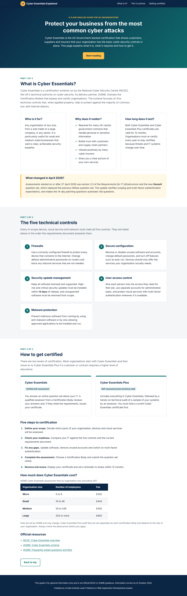
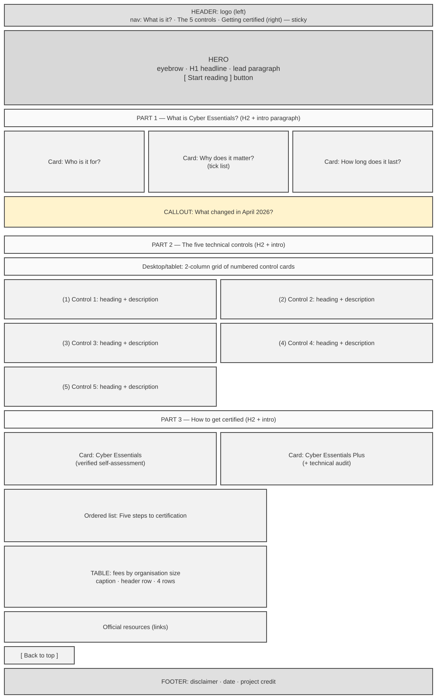
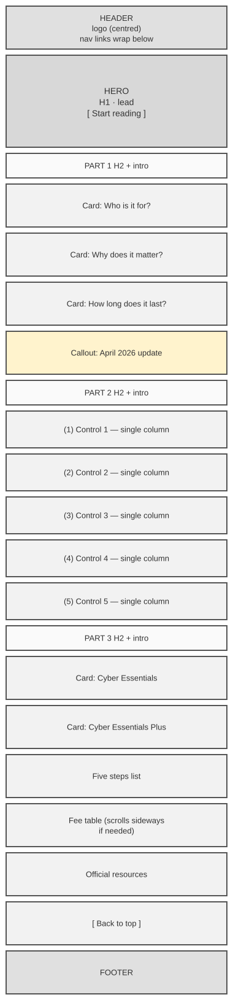
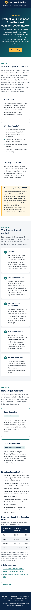
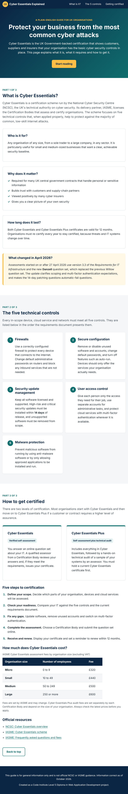

# Cyber Essentials Explained

**Cyber Essentials Explained** is a single-page, responsive website that explains the UK Government-backed **Cyber Essentials** certification to company owners and managers. It is built with semantic HTML5 and CSS3 only (no JavaScript and no external libraries) and is split into three clear page areas:

1. **What is Cyber Essentials?** – who it is for, why it matters, how long it lasts and what changed in 2026
2. **The five technical controls** – the security controls every organisation must meet
3. **How to get certified** – the two certification levels, five steps to certification, fees and official resources

[Live site](https://essexphilip.github.io/) · [Repository](https://github.com/essexphilip/)



> Replace `YOUR-GITHUB-USERNAME` in the links above once the project has been deployed (see [Deployment](#deployment)).

---

## Contents

- [Purpose of the project](#purpose-of-the-project)
- [User experience (UX)](#user-experience-ux)
  - [Target audience](#target-audience)
  - [User stories](#user-stories)
  - [Strategy plane](#strategy-plane)
  - [Scope plane](#scope-plane)
  - [Structure plane](#structure-plane)
  - [Skeleton plane – wireframes](#skeleton-plane--wireframes)
  - [Surface plane – visual design](#surface-plane--visual-design)
- [How the design meets UX principles](#how-the-design-meets-ux-principles)
- [Design decisions that depart from common conventions](#design-decisions-that-depart-from-common-conventions)
- [Features](#features)
- [Future features](#future-features)
- [Technologies used](#technologies-used)
- [File structure](#file-structure)
- [Coding standards](#coding-standards)
- [Testing](#testing)
- [Bugs](#bugs)
- [Version control](#version-control)
- [Deployment](#deployment)
- [Credits](#credits)

---

## Purpose of the project

Many small and medium-sized UK businesses are asked by customers, insurers or government buyers whether they hold Cyber Essentials, but official guidance is spread across several technical documents. The purpose of this site is to give a business owner a **short, plain-English overview on one page** so that they can understand:

- what the certification is and who runs it
- what their IT must do to pass
- what the process involves and roughly how much it costs
- where to find the official, authoritative information

The site is informational. It does not certify anyone and clearly states that it is not official NCSC or IASME guidance.

---

## User experience (UX)

The UX design followed Jesse James Garrett's **five planes of user experience**: strategy, scope, structure, skeleton and surface.

### Target audience

- Owners and directors of small and medium-sized UK businesses
- Office or IT managers who have been asked to "get Cyber Essentials"
- Sole traders bidding for public-sector or supply-chain contracts
- People with limited technical knowledge who need a quick, trustworthy overview

### User stories

| ID | As a… | I want to… | So that… | Where it is met |
|----|-------|------------|----------|-----------------|
| US1 | first-time visitor | understand immediately what the site is about | I know whether it is relevant to me | Hero headline and lead paragraph |
| US2 | business owner | learn what Cyber Essentials is and who runs it | I can trust that it is a genuine scheme | Part 1 introduction |
| US3 | business owner | know why the certification matters | I can decide whether it is worth the effort | Part 1 "Why does it matter?" card |
| US4 | returning visitor | know whether the rules have changed recently | I do not prepare against out-of-date requirements | Part 1 "What changed in April 2026?" callout |
| US5 | IT manager | see the five technical controls in a clear list | I can check our systems against them | Part 2 numbered control cards |
| US6 | business owner | understand the difference between Cyber Essentials and Cyber Essentials Plus | I can choose the right level | Part 3 comparison cards |
| US7 | business owner | follow simple steps to get certified | I know what to do next | Part 3 "Five steps to certification" |
| US8 | budget holder | see how much certification costs | I can plan for the expense | Part 3 fee table |
| US9 | any user | find official sources | I can read the full requirements | Part 3 "Official resources" |
| US10 | mobile user | read the site comfortably on my phone | I can use it anywhere | Mobile-first responsive layout |
| US11 | keyboard or screen-reader user | navigate the page without a mouse | I have the same access as other users | Skip link, focus styles, landmarks, table caption |
| US12 | any user | jump straight to the section I need | I do not have to scroll through everything | Sticky navigation bar with in-page links |

### Strategy plane

**Business goal:** provide a clear, trustworthy, accessible introduction to Cyber Essentials that encourages organisations to improve their basic cyber security.

**User goal:** get a fast answer to "What is Cyber Essentials, what do I need to do, and what will it cost?"

**Opportunities prioritised (importance / viability, 1–5):**

| Opportunity | Importance | Viability | Included in this release? |
|-------------|-----------|-----------|----------------------------|
| Explain what the scheme is | 5 | 5 | Yes |
| List the five controls | 5 | 5 | Yes |
| Explain the certification process and fees | 5 | 5 | Yes |
| Link to official sources | 5 | 5 | Yes |
| Interactive readiness checklist | 4 | 2 (needs JavaScript) | No – future feature |
| Search for a Certification Body | 3 | 1 (needs API) | No – future feature |

### Scope plane

The brief required **simple HTML and CSS only** on **one page** with **three separate page areas**. The scope was therefore limited to static, informational content with in-page navigation. Features that require JavaScript or a back end were moved to [Future features](#future-features).

### Structure plane

The content is ordered from **general to specific**, matching the questions a new user asks in turn:

```text
Header (logo + navigation)
└── Hero: what this page is and who it is for
    ├── Part 1: What is Cyber Essentials?   → "Should I care?"
    ├── Part 2: The five technical controls  → "What do I need to do?"
    └── Part 3: How to get certified         → "How do I get it and what does it cost?"
Footer (disclaimer and date)
```

- Each page area begins with a "Part X of 3" label and an `<h2>` heading so users always know where they are.
- The heading hierarchy is strictly `h1` → `h2` → `h3` with no skipped levels.
- The sticky navigation bar links directly to each of the three page areas.

### Skeleton plane – wireframes

Wireframes were produced for desktop and mobile before any code was written.

| Desktop | Mobile |
|---------|--------|
|  |  |

The tablet layout follows the desktop wireframe, with the three Part 1 cards stacked in one column until the screen is at least 1024px wide.

### Surface plane – visual design

#### Colour scheme

The palette uses deep navy and teal to suggest security and trust, with a warm amber accent for calls to action and important notices.

| Name | Hex | Use |
|------|-----|-----|
| Navy | `#0b2545` | Header, footer, headings, table header |
| Teal | `#0f6e6e` | Links, numbering, section labels, borders |
| Teal light | `#e3f2f1` | Level tags |
| Amber | `#ffbf47` | Primary button, logo, focus ring, callout border |
| Text | `#1f2933` | Body text |
| Text muted | `#4a5561` | Introductions, captions and notes |
| Background alt | `#f4f6f8` | Alternate section and table row background |

All text and background pairs meet the **WCAG 2.2 AA** contrast ratio of at least 4.5:1. The colours are defined once as CSS custom properties in `:root`, so the palette is consistent and easy to change.

#### Typography

A system font stack (`"Segoe UI", Roboto, Helvetica, Arial, sans-serif`) is used. This was chosen because:

- it loads instantly with no external requests
- these fonts are highly legible on screen
- it keeps the project free of external dependencies

Body text is 17px with a line height of 1.6, and line lengths are limited to around 45 characters wide for comfortable reading.

#### Imagery

No photographs are used. Numbered circles, tick symbols and coloured borders provide visual interest without adding download weight or decorative images that would need alternative text.

---

## How the design meets UX principles

| Principle | How it is met |
|-----------|---------------|
| **Information hierarchy** | One `h1`, one `h2` per page area and `h3` sub-headings; content is ordered from general to specific; the most important facts (controls, steps, fees) are in numbered lists, cards and a table so they are easy to scan. |
| **User control** | Users choose where to go using the sticky navigation, the "Start reading" button and the "Back to top" button. There are no pop-ups, no autoplaying media and no automatic carousels. Users who set "reduce motion" in their operating system get instant jumps instead of smooth scrolling. |
| **Consistency** | Every page area uses the same structure (label, heading, introduction, content). Cards, buttons and links share the same colours, corner radius and hover effects throughout. |
| **Confirmation and feedback** | Every link and button changes colour on hover and shows a high-contrast amber focus ring when reached by keyboard. After a navigation jump, `scroll-margin-top` keeps the section heading visible below the sticky header, confirming that the user has arrived in the right place. |
| **Accessibility** | `lang="en-GB"`; skip link; landmark elements (`header`, `nav`, `main`, `section`, `aside`, `footer`); sections labelled with `aria-labelledby`; table with `caption` and `scope` attributes; decorative logo mark hidden with `aria-hidden`; WCAG AA colour contrast; text sized in `rem` so it scales with browser settings; no information conveyed by colour alone. |

---

## Design decisions that depart from common conventions

The following decisions were made deliberately and are recorded here (and in code comments) as required:

1. **External links open in the same tab.** Many sites open external links in a new tab. This site does not, because opening new windows without warning is a known accessibility problem (WCAG Technique G201) and takes control away from the user. Users who want a new tab can choose this themselves.
2. **No hamburger menu on mobile.** With only three navigation links, the links are shown at all times and wrap if necessary. Hiding them behind a menu icon would require JavaScript and would add an extra tap for users.
3. **No contact form or other inputs.** The brief is informational only. Because there are no user inputs, there is no input validation to perform; this removes a whole category of possible user errors (see [Defensive design](#defensive-design)).
4. **The fifth control card sits alone on the last row** of the two-column grid on tablet and desktop. This was accepted rather than stretching the card, so that all five cards stay the same width and remain consistent.

---

## Features

### Existing features

**Sticky header and navigation**
- The logo returns the user to the top of the page.
- Three links take the user directly to each page area.
- The header stays visible while scrolling so navigation is always available.
- Meets user stories US1, US12.

**Skip link**
- Hidden until a keyboard user presses Tab, then shown in amber at the top of the page.
- Jumps directly to the main content.
- Meets user story US11.

**Hero section**
- States the purpose of the site in one headline and one paragraph.
- "Start reading" button takes the user to Part 1.
- Meets user story US1.

**Page area 1 – What is Cyber Essentials?**
- Introduction to the scheme, the NCSC and IASME.
- Three cards: who it is for, why it matters, how long it lasts.
- Callout box describing the April 2026 update (Danzell question set, version 3.3 requirements).
- Meets user stories US2, US3, US4.

**Page area 2 – The five technical controls**
- Five numbered cards, one per control: firewalls, secure configuration, security update management, user access control and malware protection.
- Numbers are drawn with a CSS counter on an ordered list, so screen readers still announce the list order.
- Meets user story US5.

**Page area 3 – How to get certified**
- Side-by-side comparison of Cyber Essentials and Cyber Essentials Plus.
- Ordered list of five steps to certification.
- Accessible fee table with caption, column headers and row headers; it scrolls sideways on very narrow screens instead of breaking the layout.
- Links to official NCSC and IASME resources.
- "Back to top" button.
- Meets user stories US6, US7, US8, US9.

**Footer**
- Disclaimer that the site is not official guidance and the date the information was checked.

**Responsive design**
- Mobile-first CSS with breakpoints at 768px (tablet) and 1024px (desktop).
- Tested down to 320px wide with no horizontal scrolling.
- Meets user story US10.

---

## Future features

- An interactive readiness checklist so users can tick off each control (requires JavaScript).
- A "Find a Certification Body" search using the IASME directory (requires an API and error handling).
- A dark-mode colour theme using `prefers-color-scheme`.
- A printable one-page summary using a print stylesheet.

---

## Technologies used

### Languages

- HTML5
- CSS3

### Tools

- [Git](https://git-scm.com/) – version control
- [GitHub](https://github.com/) – remote repository
- [GitHub Pages](https://pages.github.com/) – hosting
- [Visual Studio Code](https://code.visualstudio.com/) – code editor
- [W3C Markup Validation Service](https://validator.w3.org/) – HTML validation
- [W3C CSS Validation Service (Jigsaw)](https://jigsaw.w3.org/css-validator/) – CSS validation
- [WAVE](https://wave.webaim.org/) and [axe-core](https://github.com/dequelabs/axe-core) – accessibility testing
- Chrome DevTools and Lighthouse – responsiveness, performance and accessibility testing

No frameworks, libraries or JavaScript are used, so there is no `libraries` directory.

---

## File structure

All file and directory names are lower case with no spaces, for cross-platform compatibility.

```text
cyber-essentials-guide/
├── index.html                      # The single page (three page areas)
├── README.md                       # Project documentation (this file)
├── assets/
│   └── css/
│       └── style.css               # All custom styles
└── docs/
    ├── wireframes/
    │   ├── desktop-wireframe.svg
    │   └── mobile-wireframe.svg
    └── testing/
        ├── responsive-desktop.png
        ├── responsive-tablet.png
        └── responsive-mobile.png
```

---

## Coding standards

- **Separation of concerns:** HTML and CSS are in separate files; the stylesheet is linked in the `<head>`.
- **Semantic mark-up:** `header`, `nav`, `main`, `section`, `article`, `aside`, `footer`, `ol`, `ul` and `table` are used for their intended meanings.
- **Naming:** class names are lower case, hyphenated and describe purpose (for example `control-item`, `fee-table`, `area-intro`).
- **Readability:** four-space indentation throughout, no more than one blank line between blocks, and the CSS is split into 13 numbered, commented sections listed in a contents comment at the top of the file.
- **Comments:** every major HTML region and every CSS section has a comment explaining its purpose.
- **Reusability:** colours, spacing and radius are CSS custom properties.

### Defensive design

| Potential user problem | How it is handled |
|------------------------|-------------------|
| Section heading hidden under the sticky header after clicking a nav link | `scroll-margin-top` on each page area |
| Fee table too wide for a small phone | Table wrapped in `.table-wrapper` with `overflow-x: auto` |
| User sensitive to motion | Smooth scrolling disabled with `prefers-reduced-motion` |
| Keyboard user cannot see where they are | High-contrast `:focus-visible` outline on all links and buttons |
| Keyboard user has to tab through navigation on every visit | Skip link to `#main-content` |
| User enters invalid data | Not applicable – the site has no forms or inputs by design |
| Outdated fee information | Note under the table and a dated footer advise users to check current prices with IASME |

---

## Testing

### Validator testing

| File | Validator | Result | Evidence |
|------|-----------|--------|----------|
| `index.html` | [W3C Markup Validator](https://validator.w3.org/nu/) | _To complete_ | _Add screenshot_ |
| `assets/css/style.css` | [W3C Jigsaw CSS Validator](https://jigsaw.w3.org/css-validator/) | _To complete_ | _Add screenshot_ |
| `index.html` | html-validate (recommended rules, run locally) | Pass – no errors or warnings | Command-line output |

> **Before submission:** paste `index.html` and `style.css` into the official W3C and Jigsaw validators (or validate the deployed URL), save screenshots to `docs/testing/`, and update the table above. Note that Jigsaw may show *warnings* (not errors) for CSS custom properties; these are expected and can be explained here.

No JavaScript is used in this project, so no JavaScript linting is required.

### Accessibility testing

| Tool | Result |
|------|--------|
| axe-core 4 (WCAG 2.0/2.1/2.2 A and AA rules plus best practices) | 0 violations, 37 rules passed |
| WAVE | _To complete – add screenshot_ |
| Lighthouse – Accessibility | _To complete – add score and screenshot_ |
| Keyboard-only navigation | Pass – see manual tests M1–M3 |

### Lighthouse

| Category | Desktop | Mobile |
|----------|---------|--------|
| Performance | _ | _ |
| Accessibility | _ | _ |
| Best practices | _ | _ |
| SEO | _ | _ |

### Responsiveness testing

The page was tested at the following widths using browser developer tools. Full-page screenshots are in `docs/testing/`.

| Device / width | Layout | Horizontal scroll? | Result |
|----------------|--------|--------------------|--------|
| Small phone – 320px | Single column, nav on one row | No | Pass |
| Phone – 390px | Single column, nav on one row | No | Pass |
| Tablet – 820px | Header on one row, 2-column controls and level cards | No | Pass |
| Laptop – 1366px | 3-column Part 1 cards, 2-column controls | No | Pass |

| Mobile | Tablet | Desktop |
|--------|--------|---------|
|  |  |  |

### Browser testing

| Browser | Result |
|---------|--------|
| Google Chrome | _To complete_ |
| Mozilla Firefox | _To complete_ |
| Microsoft Edge | _To complete_ |
| Safari (macOS / iOS) | _To complete_ |

### Manual testing

| ID | Test | Steps | Expected result | Actual result |
|----|------|-------|-----------------|---------------|
| M1 | Skip link | Load page, press Tab once | Amber "Skip to main content" link appears; pressing Enter moves focus to the main content | As expected |
| M2 | Keyboard navigation | Press Tab repeatedly through the whole page | Every link and button receives a visible amber focus ring, in a logical order | As expected |
| M3 | Logo link | Scroll down, click the logo | Page returns to the top | As expected |
| M4 | Nav: "What is it?" | Click the link | Page scrolls to Part 1; heading visible below sticky header | As expected |
| M5 | Nav: "The 5 controls" | Click the link | Page scrolls to Part 2; heading visible below sticky header | As expected |
| M6 | Nav: "Getting certified" | Click the link | Page scrolls to Part 3; heading visible below sticky header | As expected |
| M7 | "Start reading" button | Click the button | Page scrolls to Part 1 | As expected |
| M8 | "Back to top" button | Click the button | Page returns to the top | As expected |
| M9 | Hover feedback | Hover over each nav link, button and text link | Colour changes on hover | As expected |
| M10 | External links | Click each official resource link | Correct NCSC or IASME page opens in the same tab | _Re-check before submission_ |
| M11 | Reduced motion | Turn on "reduce motion" in the OS and click a nav link | Page jumps without smooth scrolling | As expected |
| M12 | Text zoom | Zoom the browser to 200% | No content is cut off or overlaps | As expected |
| M13 | Sticky header | Scroll the full page | Header stays at the top and does not cover headings after nav jumps | As expected |

### User story testing

| User story | Test | Result |
|------------|------|--------|
| US1 | Purpose is stated in the hero headline and paragraph without scrolling on desktop and mobile | Pass |
| US2–US4 | Part 1 explains the scheme, its benefits, its 12-month validity and the 2026 update | Pass |
| US5 | Part 2 lists all five controls with descriptions | Pass |
| US6–US8 | Part 3 compares the two levels, lists five steps and shows the fee table | Pass |
| US9 | Three official links present and working | Pass (re-check before submission) |
| US10 | No horizontal scroll from 320px upwards | Pass |
| US11 | Skip link, focus states and axe-core check passed | Pass |
| US12 | Sticky nav links reach each section | Pass |

---

## Bugs

### Fixed bugs

| Bug | Cause | Fix |
|-----|-------|-----|
| On a 390px phone the navigation wrapped onto two rows, making the sticky header about 140px tall and covering a large part of the screen | Nav link padding and gap were sized for desktop | Reduced nav link padding, font size and gap on mobile, restoring the larger values at 768px and above. The header is now 96px tall on a 390px phone. |
| After the fix above, section headings could still sit just under the sticky header on mobile after a nav jump | `scroll-margin-top` of 5rem (80px) was less than the mobile header height | Set `scroll-margin-top` to 7rem on mobile and 5rem from 768px upwards |

### Unfixed bugs

There are no known unfixed bugs.

---

## Version control

The project is managed with Git and GitHub. Each feature or fix has its own small commit with a descriptive message written in the imperative mood. The planned commit sequence was:

1. `Add initial project structure and README outline`
2. `Add wireframes for desktop and mobile`
3. `Add semantic HTML skeleton with header, main and footer`
4. `Add header navigation and skip link`
5. `Add hero section content`
6. `Add page area 1: what is Cyber Essentials`
7. `Add page area 2: five technical controls`
8. `Add page area 3: certification levels, steps and fees`
9. `Add CSS variables, base styles and accessibility helpers`
10. `Style header, hero and page areas`
11. `Style cards, lists, fee table and buttons`
12. `Add responsive breakpoints for tablet and desktop`
13. `Fix mobile navigation wrapping onto two rows`
14. `Fix section headings hidden under sticky header on mobile`
15. `Add responsive screenshots and testing documentation`
16. `Document deployment procedure in README`

---

## Deployment

### Deploying to GitHub Pages

1. Sign in to [GitHub](https://github.com/) and open the `cyber-essentials-guide` repository.
2. Select **Settings** from the repository menu.
3. Select **Pages** in the left-hand sidebar.
4. Under **Build and deployment**, set **Source** to **Deploy from a branch**.
5. Set **Branch** to `main` and the folder to `/ (root)`, then select **Save**.
6. Wait one or two minutes and refresh the page. The live URL appears at the top of the Pages settings, in the form `https://YOUR-GITHUB-USERNAME.github.io/cyber-essentials-guide/`.
7. Open the live URL and repeat the manual tests to confirm that the deployed site matches the local version.

Because `index.html` is in the root of the repository, GitHub Pages serves it automatically as the home page. All file paths are relative, so no changes are needed for deployment.

### Running the project locally

**Clone the repository:**

```bash
git clone https://github.com/YOUR-GITHUB-USERNAME/cyber-essentials-guide.git
cd cyber-essentials-guide
```

Then open `index.html` in any modern web browser. No build step or server is required.

**Fork the repository:**

1. Open the repository on GitHub.
2. Select **Fork** at the top right of the page.
3. A copy of the repository is created in your own GitHub account.

---

## Credits

### Content

The facts on this site were written in my own words from the following official and industry sources (checked October 2026):

- [NCSC – Cyber Essentials overview](https://www.ncsc.gov.uk/cyberessentials/overview) – scheme purpose and the five controls
- [IASME – Cyber Essentials frequently asked questions](https://iasme.co.uk/cyber-essentials/faq-cyber-essentials) – fee bands by organisation size, the difference between Cyber Essentials and Cyber Essentials Plus, and 12-month certificate validity
- [IASME – Important update: changes to Cyber Essentials for April 2026](https://iasme.co.uk/) – Danzell question set and version 3.3 requirements
- [LRQA – Cyber Essentials changes: Danzell question set released](https://www.lrqa.com/en-gb/latest-news/cyber-essentials-changes-danzell-question-set-released/) – 27 April 2026 start date and Cyber Essentials Plus sampling changes
- [URM Consulting – Cyber Essentials update 2026](https://urmconsulting.com/blog/cyber-essentials-update-2026) – 14-day patching questions becoming automatic-fail questions

### Code

All HTML and CSS was written for this project. No code was copied from external sources and no libraries are used. The following widely documented techniques were used and are acknowledged in code comments:

- Skip link pattern – based on guidance from [WebAIM: "Skip Navigation" Links](https://webaim.org/techniques/skipnav/)
- `scroll-margin-top` for in-page anchors under a sticky header – [MDN Web Docs](https://developer.mozilla.org/en-US/docs/Web/CSS/scroll-margin-top)
- CSS counters for numbered cards – [MDN Web Docs: Using CSS counters](https://developer.mozilla.org/en-US/docs/Web/CSS/CSS_counter_styles/Using_CSS_counters)
- `prefers-reduced-motion` – [MDN Web Docs](https://developer.mozilla.org/en-US/docs/Web/CSS/@media/prefers-reduced-motion)

### Acknowledgements

- Code Institute for the Level 5 Diploma in Web Application Development assessment criteria.
- The National Cyber Security Centre and IASME for publishing clear public guidance on the scheme.
